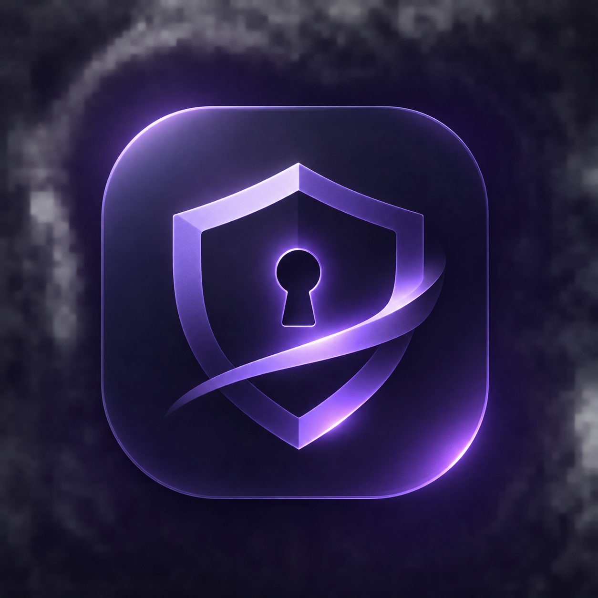

# Umbra Vault 1.1.1



Офлайн-менеджер паролей для Windows 11 x64. Разработчик Umbra.

## Установка

Для установки скачайте `UmbraVault-Setup-1.1.1.exe` из раздела Releases репозитория. Установщик работает от имени текущего пользователя. Папку программы можно выбрать, ярлык на рабочем столе опционален. В меню «Пуск» появится Umbra Vault. Python на компьютере пользователя не требуется.

Перед установкой сравните SHA-256 с [контрольной суммой](release/SHA256SUMS.txt).

```powershell
Get-FileHash .\UmbraVault-Setup-1.1.1.exe -Algorithm SHA256
```

На стартовом экране выберите «Создать хранилище…» и укажите место для файла `.umbra`, либо выберите «Открыть файл…». Для каждого нового файла задаётся свой мастер-пароль. Записи, папки и иконки этого хранилища сохраняются в одном зашифрованном файле.

Чтобы сменить файл, нажмите «Закрыть файл» в боковой панели. Кнопка доступна после завершения сохранения. Стартовый экран предлагает открыть последний успешно открытый файл или прежнее хранилище по пути `%LOCALAPPDATA%\Umbra Vault\Data\vault.umbra`, если оно существует. Мастер-пароль восстановить нельзя.

Создайте папку кнопкой «Новая папка» в боковой панели. Правый клик по папке открывает переименование, выбор цвета и удаление. В редакторе записи поле «Папка» позволяет выбрать назначение или убрать запись из папки. При удалении папки её записи остаются в общем списке.

Ctrl+N создаёт запись, Ctrl+K и Ctrl+F переводят фокус на поиск, Ctrl+L блокирует хранилище. Контекстное меню открывается правой кнопкой, клавишей меню или Shift+F10.

## Запуск из исходников

```powershell
py -3.12 -m venv .venv
.\.venv\Scripts\python.exe -m pip install .
.\.venv\Scripts\python.exe -m app.main
```

После настройки также работает `Launch Umbra Vault.cmd`. Для демонстрации из исходников запустите `python -m app.main --demo`. Файл с реальными записями в деморежиме не открывается. В установщик входят только функции локального хранилища.

Лицензия Umbra Vault ожидает согласования. Сведения о сторонних библиотеках доступны в настройках и в [уведомлениях](packaging/THIRD_PARTY_NOTICES.txt).

[Сборка и ручная проверка](docs/windows-release.md) · [Модель угроз](SECURITY.md) · [Изменения](CHANGELOG.md) · [Примечания к релизу](release/RELEASE_NOTES.md)
